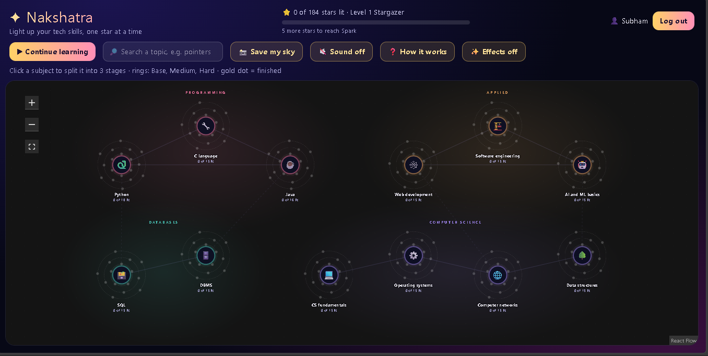

# ✦ Nakshatra

**Light up your tech skills, one star at a time.**

Nakshatra turns a computer science syllabus into a night sky. Every subject (Python, SQL, Java, networks and more) is a glowing planet. Open a subject and it **splits into three stages: Base, Medium and Hard**. Each subtopic is a star, and you light it when you have learned it. The more you light, the brighter the planet and its constellation glow.

Built solo for the **Appwrite Databases Hackathon (October 2026)** on **Appwrite TablesDB**.

- 🔗 **Live demo:** https://nakshatra-pi.vercel.app
- 🎥 **Demo video:** [ADD YOUR VIDEO LINK HERE]

## Why I built it

Students in BCA and computer engineering often know *what* they should study but not *where to start* or *what comes next*. Syllabus PDFs and long lists are easy to ignore. Nakshatra shows the same material as a map you want to fill in, so progress is visible and every topic has a clear place.

## How it works

1. **Pick a subject** from the sky. 12 subjects are grouped into four constellations: Programming, Databases, Computer science and Applied.
2. **It splits into 3 stages.** Stage 1 is Base, Stage 2 is Medium and Stage 3 is Hard, each with its own subtopics.
3. **Light the stars.** Tick a subtopic and its star turns gold. Finish a stage and its path glows. Finish all three and the subject is mastered.
4. **Keep going.** Levels, a daily streak and a "Continue learning" button show you where to go next.

## Features

- 12 subjects, 36 stages and 184 subtopics for BCA and computer science students
- Planets with three orbit rings (Base, Medium, Hard) whose dots light up as you learn
- A split view that opens each subject into its three stages
- Sign up and log in, with progress saved privately to your own account
- Levels from Stargazer to Galaxy master, a daily streak and celebrations when you finish a stage or a subject
- Search for any topic, such as "pointers" or "subnetting", and jump straight to it
- **Save my sky:** download a picture card of your progress to share
- Optional sound and an Effects switch for people who prefer less motion
- Works on phones

## How it uses Appwrite Databases

Nakshatra is built on **Appwrite TablesDB** and the data is organised in four related tables:

| Table | What it stores | Who can read it |
|---|---|---|
| `skills` | The subjects: name, category, description, icon | Everyone |
| `stages` | Three stages per subject (Base, Medium, Hard), linked to a subject with `skill_id` | Everyone |
| `topics` | The subtopics, linked to a stage with `stage_id` and to a subject with `skill_id`, with a position and a one-line note | Everyone |
| `topic_progress` | One row per topic a user has lit, linked with `user_id` and `topic_id` | Only that user |

Highlights:

- **Linked data:** subjects have stages, and stages have topics. The app loads the tables and joins them in the browser, so adding a new subject, stage or topic needs only new rows and no code change.
- **Row-level security:** every `topic_progress` row is created with permissions for the signed-in user only (`Permission.read(Role.user(userId))`), so nobody can see another person's progress.
- **Public reference data:** the subject, stage and topic tables are readable by everyone and not writable from the browser.
- **Appwrite Auth:** email and password accounts and sessions.
- **CSV import:** all subjects, stages and topics were loaded with Appwrite's CSV import.
- **Row timestamps:** the learning streak is calculated from the `$createdAt` time Appwrite stores on each progress row.

## Tech stack

- [Appwrite](https://appwrite.io) Cloud: TablesDB and Auth, through the `appwrite` JavaScript SDK
- React 19 and Vite
- [React Flow](https://reactflow.dev) (`@xyflow/react`) for the sky

## Credits

- The project began from Appwrite's open-source [React starter](https://github.com/appwrite/starter-for-react) template. The app, the database design and all of the subject content were written for this hackathon.
- The sky is drawn with React Flow.

## Run it yourself

1. Clone this repo and run `npm install`.
2. In Appwrite Cloud, create a project and add a **Web** platform with the hostname `localhost`.
3. Create a TablesDB database with these tables and columns (all text columns are strings):
   - `skills`: `name`, `category`, `description`, `icon`, and an integer `tier` that the app ignores
   - `stages`: `skill_id`, `position` (integer), `title`, `summary`
   - `topics`: `stage_id`, `skill_id`, `position` (integer), `title`, `note`
   - `topic_progress`: `user_id`, `topic_id`
4. Give `skills`, `stages` and `topics` the permission **Any: Read**. Give `topic_progress` the permission **Users: Create** with row security turned on.
5. Import the subject data into the first three tables.
6. Put your endpoint, project ID, database ID and table IDs at the top of `src/lib/api.js`.
7. Run `npm run dev` and open the link it prints. Open `/#check` to see whether every table is connected.

## Screenshots

<!-- Add screenshots here, for example:  -->
